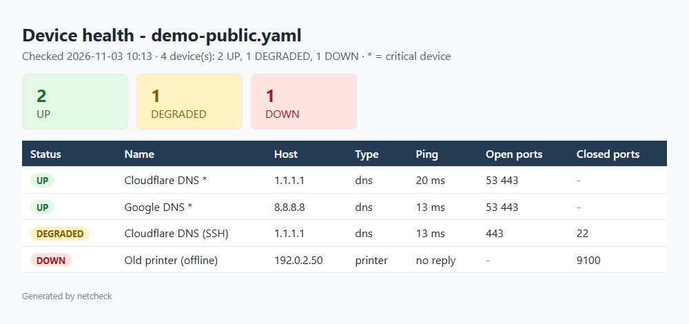

# Network Health Checker

[](https://github.com/ManojFam/network-health-checker/actions/workflows/ci.yml)

`netcheck` is a small Python command-line tool for answering the first question in most
network tickets: **what is up, what is down, and what is half-working?**

- **`netcheck check devices.yaml`** checks a list of devices (switches, servers, printers,
  and so on). It pings each one and tries the TCP ports it should have open, then marks each
  device **UP**, **DEGRADED** or **DOWN**.
- **`netcheck sweep 192.168.1.0/24`** finds the live hosts in a subnet and shows which
  common ports they have open.
- Reports go to the console and, if you ask, to **CSV** (for Excel) and a self-contained
  **HTML** page (to attach to a ticket).
- Exit codes follow the **Nagios plugin convention**, so the check can run from Task Scheduler,
  cron, Nagios, Icinga or PRTG and raise an alert when a critical device goes down.

It runs on Windows, Linux and macOS with Python 3.10+. The only dependency is PyYAML.

## Quick start

```bash
git clone https://github.com/ManojFam/network-health-checker.git
cd network-health-checker
python -m venv .venv
# Windows: .venv\Scripts\activate    Linux/macOS: source .venv/bin/activate
pip install -e .

netcheck check examples/demo-public.yaml        # public hosts, works anywhere
netcheck check examples/devices.yaml --html report.html --csv report.csv
netcheck sweep 192.168.1.0/24 --ports 22,80,443,3389 --resolve
```

`python -m netcheck ...` works too. Run `netcheck check -h` or `netcheck sweep -h` for all
the options (`--timeout`, `--workers`, `--csv`, `--html`).

Only scan networks you manage or have permission to scan.

## Sample output

[samples/demo-output.txt](samples/demo-output.txt) is a real run against public DNS
servers plus an address reserved for documentation that never answers:

```text
$ netcheck check examples/demo-public.yaml --csv samples/demo-report.csv --html samples/demo-report.html
STATUS    NAME                   HOST        PING   PORTS
--------  ---------------------  ----------  -----  -------------------
UP        Cloudflare DNS *       1.1.1.1     20 ms  open 53,443
UP        Google DNS *           8.8.8.8     13 ms  open 53,443
DEGRADED  Cloudflare DNS (SSH)   1.1.1.1     13 ms  open 443; closed 22
DOWN      Old printer (offline)  192.0.2.50  -      closed 9100

4 device(s): 2 UP, 1 DEGRADED, 1 DOWN
CSV report:  samples/demo-report.csv
HTML report: samples/demo-report.html

$ echo $?
1
```

`*` marks a critical device. The exit code is 1 (WARNING) because something is DEGRADED or
DOWN, but no *critical* device is down.

The HTML report ([samples/demo-report.html](samples/demo-report.html)):



The CSV ([samples/demo-report.csv](samples/demo-report.csv)):

```text
name,host,type,critical,status,ping,latency_ms,open_ports,closed_ports,checked_at
Cloudflare DNS,1.1.1.1,dns,yes,UP,reply,20,53 443,,2026-11-03T10:13:42+11:00
Old printer (offline),192.0.2.50,printer,no,DOWN,no reply,,,9100,2026-11-03T10:13:44+11:00
```

## The device file

YAML ([examples/devices.yaml](examples/devices.yaml)):

```yaml
devices:
  - name: File server
    host: 192.168.1.11      # IP address or DNS name
    type: server            # free text, shown in reports
    ports: [445, 3389]      # TCP ports that should be open
    critical: true          # DOWN => exit code 2 (CRITICAL)

  - name: Reception printer
    host: 192.168.1.50
    type: printer
    ports: [9100, 80]
```

Or CSV ([examples/devices.csv](examples/devices.csv)), easy to keep in Excel:

```text
name,host,type,ports,critical
File server,192.168.1.11,server,445;3389,yes
```

Every entry is validated when the file loads. A bad port, a missing host or a host that is not
a valid name or IP address stops the run with a message naming the entry, for example
`device #2: 'host' is required`.

## How status and exit codes work

| Status | Meaning |
|---|---|
| **UP** | Every listed port is open. With no ports listed, it answers ping. |
| **DEGRADED** | The device answers, but something expected is missing. Example: a printer that pings but has its web page closed. |
| **DOWN** | No ping reply and no open ports. |

A device with all its ports open counts as UP even without a ping reply, because Windows
Firewall blocks ping by default. Ping on its own is not proof that a device is down.

| Exit code | When | Nagios name |
|---|---|---|
| 0 | every device is UP | OK |
| 1 | something is DEGRADED, or a non-critical device is DOWN | WARNING |
| 2 | a device marked `critical` is DOWN | CRITICAL |
| 3 | bad arguments or device file, so nothing was checked | UNKNOWN |

`sweep` is for discovery, so it exits with 0 however many hosts answer.

Example of a scheduled task that only alerts when something is wrong (Windows):

```bat
netcheck check C:\netcheck\devices.yaml --html C:\netcheck\report.html
if errorlevel 1 (echo Network check failed, see C:\netcheck\report.html)
```

## How it is built

```text
netcheck/
  probes.py    ping (system ping command) and TCP connect; host validation
  config.py    loads and validates the YAML / CSV device file
  scanner.py   runs probes in parallel, decides UP / DEGRADED / DOWN, subnet sweep
  report.py    console table, CSV and HTML output
  cli.py       argparse commands and exit codes
tests/         pytest suite
examples/      device files
```

Design choices:

- **Uses the system `ping` command, not raw ICMP sockets.** Raw sockets need
  administrator or root rights. The ping flags differ per OS (`-n`/`-w` in milliseconds on
  Windows, `-c`/`-W` in seconds on Linux), and `build_ping_command` handles that.
- **Does not trust the Windows ping exit code.** Windows `ping` exits with 0 when a
  router replies "Destination host unreachable". A reply only counts if the output contains
  a `TTL`, which only real echo replies have.
- **Validates hosts before they reach a command.** Hosts must look like a hostname or IP
  address. Anything starting with `-` (which `ping` would read as an option) or containing
  spaces or shell characters is rejected. Commands are run without a shell.
- **Port checks are full TCP connects**, the same as a real client. "refused" means the
  host is up with nothing listening. "timeout" usually means the host is down or a firewall
  drops the traffic.
- **Threads for speed.** The checks spend their time waiting on the network, so a
  `ThreadPoolExecutor` checks 32 devices at once (64 for sweeps). A /24 sweep finishes in
  seconds. Results keep the order of the device file.
- **Sweeps are capped at 1,024 addresses**, so a typo like `/16` doesn't start a
  65,000-host scan.
- **Easy to test.** The scanner accepts the ping and port-check functions as parameters.
  The tests swap in a fake network, so no real traffic is needed (see `tests/conftest.py`).

## Tests

```bash
pip install -e ".[dev]"
pytest
ruff check . && ruff format --check .
```

There are 75 tests. They cover ping command building and output parsing for Windows and
Linux (including the "Destination host unreachable" case), host validation, config loading
and error messages, every status combination, subnet maths, the reports (including HTML
escaping) and every CLI exit code. Port checks are tested against a real listening socket on
localhost. GitHub Actions runs lint and tests on Ubuntu (Python 3.10 and 3.13) and Windows
(Python 3.13).

## License

[MIT](LICENSE)
